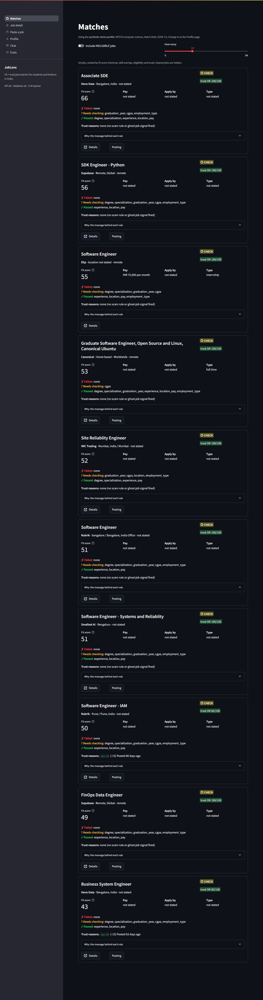
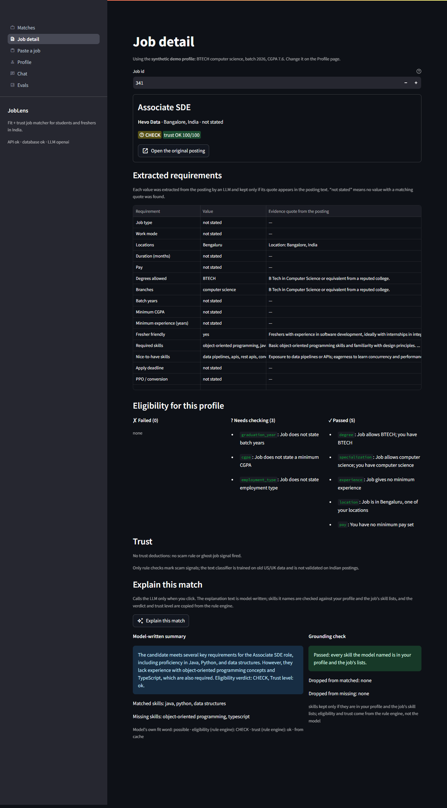
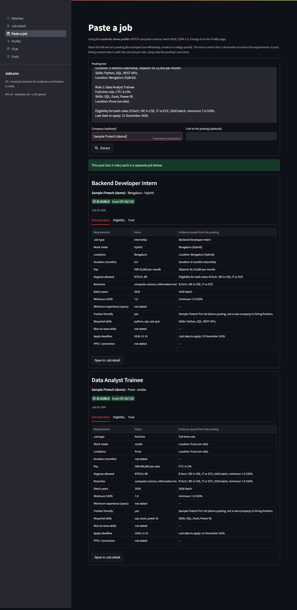
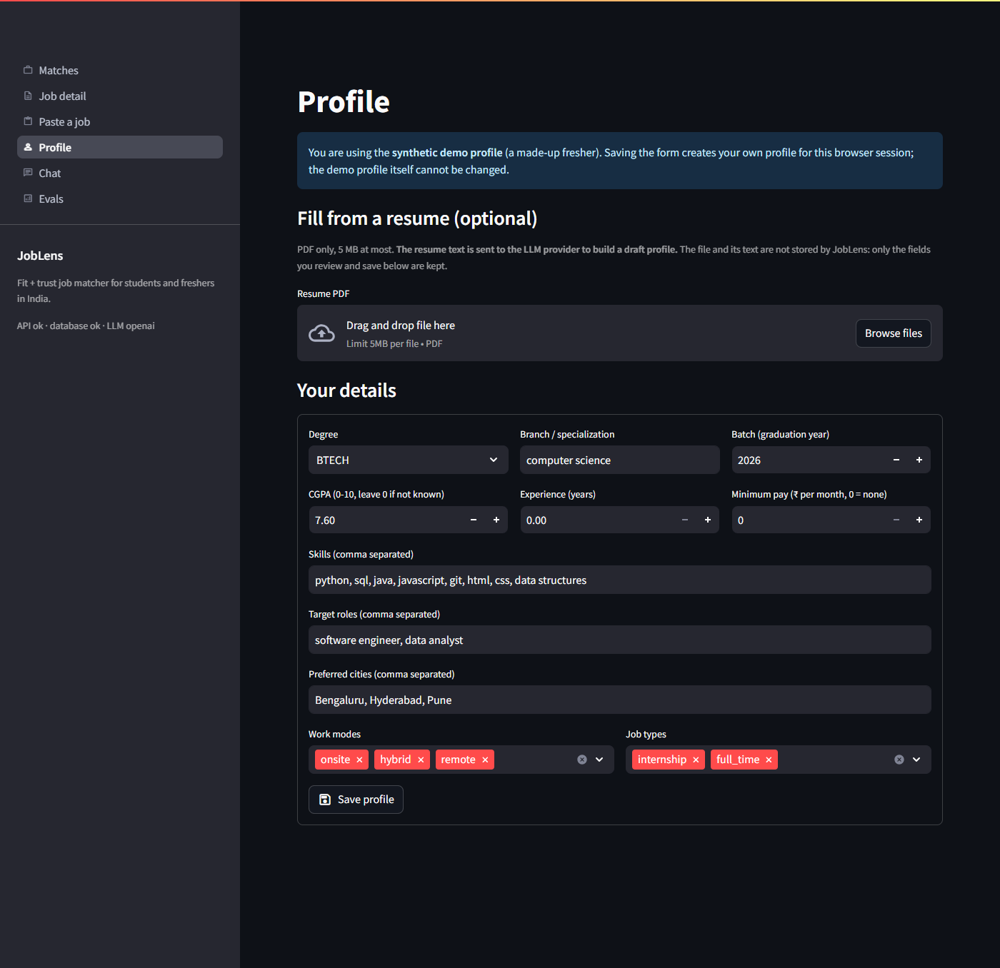
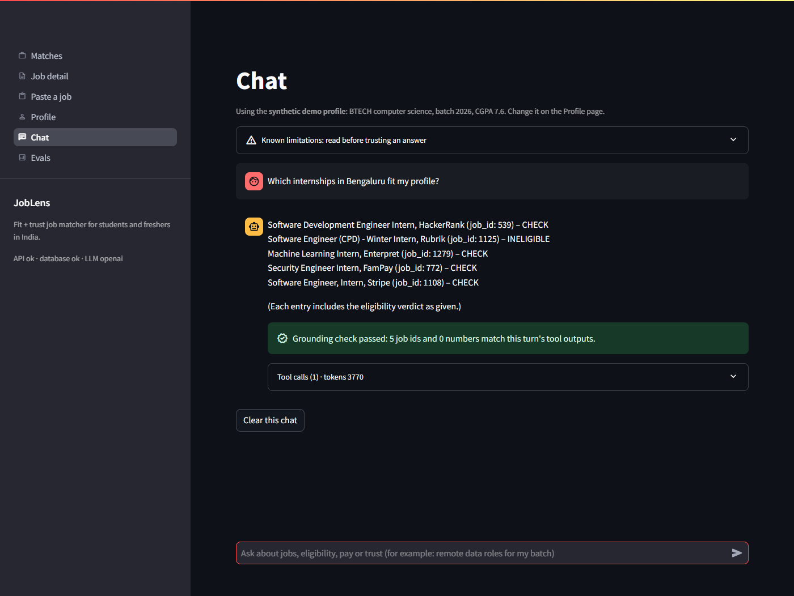
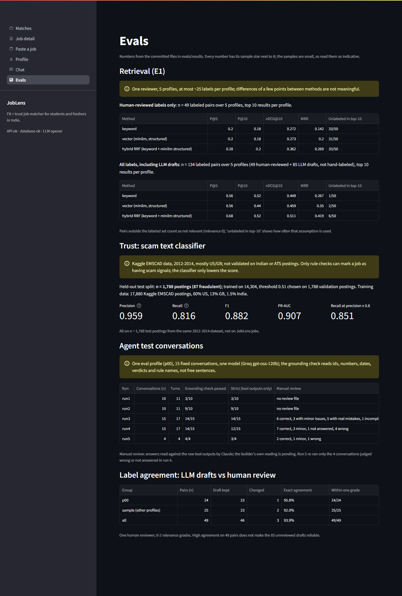
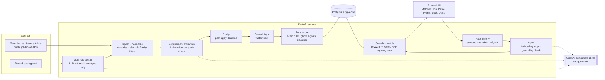

# JobLens

**A fit + trust job matcher for students and freshers in India.** JobLens collects internships and entry-level jobs
from public company job boards (Greenhouse, Lever, Ashby) and from postings you paste (WhatsApp forwards, college
portals, email). For each job it shows:

- **Fit**: how well the job matches your profile, plus a rule-based eligibility check (degree, branch, batch year,
  CGPA, experience, location, pay, job type) with the exact rules that passed, failed or need checking.
- **Trust**: a trust score with its reasons: scam rules (fee requests, off-platform contact, unrealistic pay),
  ghost-job signals (old or reposted postings) and a text classifier.
- **Evidence**: every requirement extracted from a posting is kept only if its quote appears in the posting text,
  and the UI shows that quote next to the value.

It is for freshers who see many postings with unclear eligibility and some that are fake, and want to know quickly
which ones they can apply to and which to be careful with.

> Local project. There is no live demo. The screenshots below were taken from a local run with a synthetic demo
> profile.

## Screenshots

| Matches | Job detail |
|---|---|
| [](docs/screenshots/matches.png) | [](docs/screenshots/job_detail.png) |
| **Paste a job** (a two-role post split into two jobs) | **Profile** |
| [](docs/screenshots/paste.png) | [](docs/screenshots/profile.png) |
| **Chat** | **Evals** |
| [](docs/screenshots/chat.png) | [](docs/screenshots/evals.png) |

<!-- Screenshot placeholders: re-take with `python scripts/ui_screenshots.py --ui http://127.0.0.1:8501` -->

## Architecture



- **Stack:** Python 3.12, FastAPI, Postgres 16 + pgvector, SQLAlchemy + Alembic, fastembed, any OpenAI-compatible
  LLM API (Groq and Gemini by default), Streamlit and Docker Compose. No LangChain or agent framework: the agent loop
  (`app/agent/loop.py`) is about 160 lines of plain Python.
- **LLM output never sets a card value directly.** Extracted values need a matching quote from the posting.
  Eligibility and trust come from rule code. The agent's answers go through a grounding check, which compares job
  ids, numbers, dates, verdicts, rule names and "not listed" claims with that turn's tool outputs. Model-written text
  is labeled as such in the UI.

## Run it locally (Docker Compose)

```bash
cp .env.example .env
```

Edit `.env` **before** the first start:

- `ADMIN_API_KEY`: set a random string of 12 or more characters (for example the output of
  `python -c "import secrets; print(secrets.token_hex(16))"`). The `change-me` placeholder from `.env.example` is
  refused, so the ingest call below returns 401 until you change it. If you change `.env` later, run
  `docker compose up -d` again so the API picks it up.
- `LLM_API_KEY` (Groq) and `GEMINI_API_KEY`: optional. Without them, JobLens uses an offline heuristic extractor and
  a fake LLM: chat and explanations are canned, extraction is rule-based, and multi-role pasted posts are not split
  (the whole post becomes one job, titled by its first line).

```bash
docker compose up --build
```

- API: <http://localhost:8000> (health at `/health`, docs at `/docs`)
- UI: <http://localhost:8501>

Compose uses host ports 8000, 8501 and 5433, so stop anything else on those ports first.

Migrations run when the API starts. The database starts empty: fetch jobs from the configured boards (this runs
extraction, embeddings and trust for each new job, in the background):

```bash
curl -X POST http://localhost:8000/admin/ingest -H "X-API-Key: <your ADMIN_API_KEY>"
```

The call returns `{"status":"started"}` at once. A full run over all configured boards takes several minutes; jobs
show up on the Matches page as they are processed (`docker compose logs -f api` shows progress). On the first run the
embedding models are downloaded into `./models`.

On a fresh checkout the trust score uses the rule checks and ghost-job signals only: the scam text classifier is not
in the repository (`/health` shows `"scam_classifier": {"present": false}`). To add it, download the Kaggle EMSCAD
file to `data/raw/fake_job_postings.csv` and run `python -m ml.train_scam_classifier`.

The UI starts with a **synthetic demo profile** (a made-up B.Tech CSE 2026 fresher). Save your own profile on the
Profile page; a resume PDF can pre-fill the form.

### Demo safety

- **Rate limits:** chat, paste, explain and resume upload are limited per browser session and per day (see
  `limits` in `config/settings.yaml`). They are also refused with a clear message when that purpose's daily LLM token
  budget is used up.
- **Resumes:** files are PDF only and 5 MB at most. The resume text is sent to the LLM provider to build a draft, and
  neither the file nor its text is stored or logged.
- **Admin routes** need `X-API-Key`. The API sends no CORS headers; the UI calls it server-side.
- **Logs** hold argument names and sizes, not message text or search queries.
- **The demo profile** cannot be edited, deleted or given chat memory.

### Development

```bash
pip install -r requirements-dev.txt
```

```bash
ruff check . && mypy app evals ml && pytest -q
```

Database tests need Postgres with pgvector at `TEST_DATABASE_URL`.

## Results

All numbers come from `evals/results/`. The samples are small, so read them as indicative, not as benchmarks.

### Retrieval (E1): top 10 per profile, 5 profiles

| Labels | n (labeled pairs) | Method | P@5 | P@10 | nDCG@10 | MRR |
|---|---|---|---|---|---|---|
| Human-reviewed only | 49 | keyword | 0.200 | 0.180 | 0.272 | 0.142 |
| | 49 | vector (MiniLM) | 0.200 | 0.180 | 0.273 | 0.200 |
| | 49 | hybrid (RRF) | 0.280 | 0.200 | 0.362 | 0.269 |
| Including LLM drafts | 134 (49 human + 85 drafts) | keyword | 0.560 | 0.520 | 0.449 | 0.267 |
| | 134 | vector (MiniLM) | 0.560 | 0.440 | 0.459 | 0.350 |
| | 134 | hybrid (RRF) | 0.680 | 0.520 | 0.511 | 0.419 |

The 49 human-reviewed labels were reviewed by the builder (one reviewer), with at most about 25 labels per
profile, so differences of a few points are not meaningful. Unlabeled jobs in a top 10 count as not relevant: with human labels only, 31 to 33 of the 50 top-10
results were unlabeled. The 85 drafts were written by an LLM (qwen) and were not hand-labeled. On the 49 pairs that
were reviewed, the drafts agreed with the human grade on 46 (93.9%).

### Trust: scam text classifier

| Test set | Precision | Recall | F1 | PR-AUC |
|---|---|---|---|---|
| Kaggle EMSCAD held-out split, n = 1,788 (87 fraudulent) | 0.959 | 0.816 | 0.882 | 0.907 |

**Caveat:** the classifier is trained on Kaggle EMSCAD postings from 2012–2014 (17,880 postings: 60% US, 13% GB,
1.5% India). It is **not validated on Indian postings** or on today's job boards. In JobLens it can only lower the
trust score; only the rule checks can mark a job as having scam signals.

### Agent test conversations: one eval profile, one model (Groq gpt-oss-120b)

| Run | Conversations (n) | Grounding check passed | Manual review |
|---|---|---|---|
| Run 3 | 15 | 14/15 | 6 correct, 3 minor, 5 wrong, 1 incomplete |
| Run 4 | 15 | 14/15 | 7 correct, 3 minor, 1 not answered, 4 wrong |
| Run 5 (re-ran the 4 wrong or unanswered) | 4 | 4/4 | 2 correct, 1 minor, 1 wrong |

The agent's answers were checked against raw tool outputs in a manual review (files in
`evals/results/agent_run*/manual_review.md`). A passing grounding check does not mean a correct answer: the check
cannot read free sentences.

## Known limitations

- **Agent mistakes that remain** (15 test conversations on one profile):
  - **Whole-database questions:** it answers these from one 5-result search. "Which job pays the most" got "no
    information", although 9 searchable jobs list pay. There is no sort-by-pay tool, and the agent often invents a
    narrow query.
  - **Missing job types:** most job-board postings have no extracted job type, so a "full-time" filter drops them
    without saying so.
  - **Summary lines:** closing sentences can overgeneralize ("all are internships", "your skills are compatible"),
    and the grounding check cannot see this.
  - **Terse answers:** it is sometimes too terse and can leave out the rule list or name matches it fetched.
  - **Explanations:** the match explanation can call a CHECK job "meets all the conditions".
  - **Test scope:** one profile, 15 conversations and one model. The Groq free tier (about 200K tokens a day) limits
    how much can be tested.
- **Region in a title:** the India rule reads locations and time-zone wording, not titles. A role titled
  "... - Europe" can stay in scope.
- **Multi-role posts:** they are split by an LLM that returns line ranges only. Shared header and footer lines are
  copied into every role, so role-specific lines in the shared parts are not separated. A role without its own
  heading gets "Needs human title". This was tested on one real post.
- **Work mode for pasted jobs** holds one value, so "on-site or remote" is stored as remote only.
- **Retrieval labels are small and partly LLM-drafted:** 49 human-reviewed pairs. The larger set of 134 includes 85
  LLM drafts that no one hand-labeled.
- **Trust classifier:** trained on old US/UK Kaggle data (see Results) and not validated on Indian postings.
- **Deadlines:** few postings state one, so expiry covers only those. The expiry step runs in the pipeline and on
  demand, not on a daily schedule.
- **Rate limits** key on a browser-session id that a client could change. The per-day limit still caps the total.
  Resume uploads use an in-memory LLM cache (so nothing from them is stored), which means their tokens are not
  counted in the daily budget.

## How this was built

Built with Claude Code from a spec I wrote. I reviewed the retrieval labels myself (49 pairs). The agent's
answers were checked against raw tool outputs in a manual review (files in evals/results), and the mistakes that
remain are listed in Known limitations.
